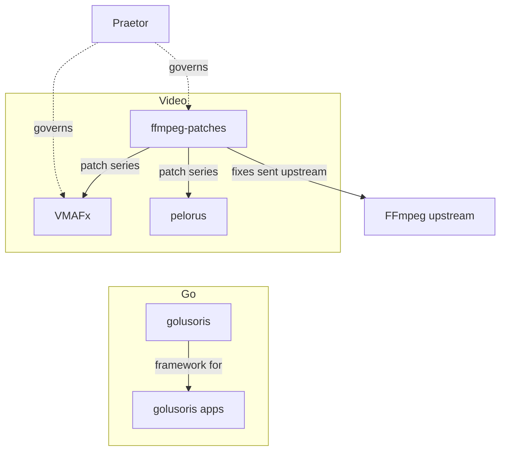

### Hi, I'm Kilian

**I build open-source tooling for video quality, Go and SvelteKit frameworks, and for keeping fleets of coding agents honest.**

### Vision

I want a video quality score to mean the same on every device, so in VMAFx every GPU backend and SIMD path is checked against the CPU reference scores. Fixes go back where they belong: every fix in ffmpeg-patches is also sent upstream, and [15 of my pull requests](#upstream) are merged across 7 projects. A result counts only with the evidence that shows it: a requested backend that is missing fails instead of falling back silently, and a gate that cannot run is not a passing gate. Every coding agent should follow the same rules, so [Praetor](https://github.com/cordanaLLM/praetor) (said PREE-tor; Latin *praetor*, an elected magistrate of ancient Rome whose rulings set legal precedent) compiles one AGENTS.md per repository into the instruction files of [six coding clients](https://github.com/cordanaLLM/praetor#2-context-transpilation).

### VMAFx

[VMAFx](https://github.com/VMAFx/vmafx) is a fork of [Netflix/vmaf](https://github.com/Netflix/vmaf). VMAF (Video Multi-Method Assessment Fusion) is Netflix's perceptual video quality metric; VMAFx keeps Netflix's reference scores, and the [three Netflix reference pairs](https://github.com/VMAFx/vmafx#-why-vmafx) are a required CI gate.

It adds GPU backends (CUDA, SYCL, HIP, Metal) and SIMD paths (AVX2, AVX-512, NEON, SVE2), each checked against the CPU scores, and ships ONNX tiny models with a signed registry, an MCP server, FFmpeg filters, a Kubernetes operator, and Go and Rust bindings.

So far: [more than 2,350 merged pull requests](https://github.com/VMAFx/vmafx/pulls?q=is%3Apr+is%3Amerged) and [three release candidates](https://github.com/VMAFx/vmafx/releases), the newest v1.0.0-rc.3; no stable release yet.

**What funding unlocks**

- CI time, the largest running cost: the Linux, Windows and macOS build matrix, the numerical-exactness gates and the sanitizer jobs.
- Regular cloud GPU test runs on hardware I do not own, so every GPU backend keeps being checked against the CPU reference.
- The two FFmpeg filter parity checks that cannot run in CI today: hqdn3d_cuda needs an NVIDIA device, and the Metal filters need an Apple host.
- Next, an AI workstation for training and evaluating the tiny models, once the first goal of [250 USD a month](https://github.com/sponsors/lusoris) is met.

Sponsor through [GitHub Sponsors](https://github.com/sponsors/lusoris).

### How the pieces connect

cordanaLLM is moving: products and tools go to Tekmora (said TEK-mo-ra, from Greek *tekmor*: a set goal, and the sign that shows the way to it), shared libraries and frameworks to Plurano (said plu-RAH-no, from Latin *plures*, many); nothing is deleted.

### Projects

Video: VMAFx, ffmpeg-patches, pelorus

| Project | What it is |
| :-- | :-- |
| [VMAFx](https://github.com/VMAFx/vmafx) | Perceptual video quality assessment (VMAF), GPU-accelerated and SIMD-tuned, every backend checked against the CPU scores |
| [ffmpeg-patches](https://github.com/VMAFx/ffmpeg-patches) | One shared series of [39 FFmpeg fixes](https://github.com/VMAFx/ffmpeg-patches/tree/main/patches) in git format-patch form, applied onto one pinned FFmpeg release and sent upstream |
| [pelorus](https://github.com/VMAFx/pelorus) | GPU pre-encode pipeline, sibling of VMAFx |

Go and web: golusoris, goenvoy, sveltesentio

| Project | What it is |
| :-- | :-- |
| [golusoris](https://github.com/golusoris/golusoris) | To be renamed columen (said KOL-oo-men; Latin *columen*, the ridge-beam or central pillar that holds a frame together). Composable Go framework: opt-in fx modules for what a production backend needs (config, log, db, http, otel, jobs, cache, auth, k8s) |
| [goenvoy](https://github.com/golusoris/goenvoy) | Go client libraries for media automation, metadata and download APIs, as zero-dependency modules |
| [sveltesentio](https://github.com/golusoris/sveltesentio) | Composable SvelteKit framework |

Agents and systems: Praetor, Diallak, nucleus

| Project | What it is |
| :-- | :-- |
| [Praetor](https://github.com/cordanaLLM/praetor) | Open governance engine for any repository fleet: one canonical AGENTS.md per repository, compiled into the instruction files of [six coding clients](https://github.com/cordanaLLM/praetor#2-context-transpilation) |
| [Diallak](https://github.com/tekmora/diallak) | Community bot that answers from the documentation and cites it. The name (said dee-AHL-lak) is from Greek *diallaktes*, the impartial mediator. |
| [nucleus](https://github.com/cordanaLLM/nucleus) | Deterministic Linux kernel builds with hardened configuration |

Media: SnatchArr

| Project | What it is |
| :-- | :-- |
| [SnatchArr](https://github.com/lusoris/SnatchArr) | Finds missing media across *arr instances while respecting hourly caps |

### Upstream

Fixes that left my own trees and were merged where they belong:

<!-- upstream:start -->
| Project | Merged |
| :-- | --: |
| [FFmpeg](https://ffmpeg.org/) | [8](https://code.ffmpeg.org/FFmpeg/FFmpeg/pulls?state=closed&poster=1392) |
| [OpenVINO Model Server](https://github.com/openvinotoolkit/model_server) | [2](https://github.com/openvinotoolkit/model_server/pulls?q=is%3Apr+is%3Amerged+author%3Alusoris) |
| [Vulkan Validation Layers](https://github.com/KhronosGroup/Vulkan-ValidationLayers) | [1](https://github.com/KhronosGroup/Vulkan-ValidationLayers/pulls?q=is%3Apr+is%3Amerged+author%3Alusoris) |
| [Paperclip](https://github.com/paperclipai/paperclip) | [1](https://github.com/paperclipai/paperclip/pulls?q=is%3Apr+is%3Amerged+author%3Alusoris) |
| [Paperclip Aperture](https://github.com/tomismeta/paperclip-aperture) | [1](https://github.com/tomismeta/paperclip-aperture/pulls?q=is%3Apr+is%3Amerged+author%3Alusoris) |
| [Hindsight](https://github.com/vectorize-io/hindsight) | [1](https://github.com/vectorize-io/hindsight/pulls?q=is%3Apr+is%3Amerged+author%3Alusoris) |
| [helm-charts](https://github.com/intel/helm-charts) | [1](https://github.com/intel/helm-charts/pulls?q=is%3Apr+is%3Amerged+author%3Alusoris) |
<!-- upstream:end -->

code.ffmpeg.org has no merged filter, so the FFmpeg count links to my closed pull requests there: [8 of the 11](https://code.ffmpeg.org/FFmpeg/FFmpeg/pulls?state=closed&poster=1392) are merged.

More are in review. I report what I find with a reproduction and a measurement, and I send the fix when I have one.

### Support my work

One GitHub Sponsors profile covers VMAFx and my open-source work in every organisation above. Choose any amount, monthly or once; sponsorship buys no support and no priority.

- GitHub Sponsors: [github.com/sponsors/lusoris](https://github.com/sponsors/lusoris)
- Open Collective: account pending, link follows.

### Working with me

- Bug reports with a reproduction are the fastest way to get something fixed.
- Every project states its licence and credits what it builds on.
- Questions about a project go to that project's discussions.

My avatar is a character in the style of the Go gopher. The Go gopher was designed by Renee French and is licensed under the Creative Commons Attribution 4.0 licence. The upstream section is generated from <a href="upstream.json">upstream.json</a> by <a href="tools/render.py">tools/render.py</a>.
